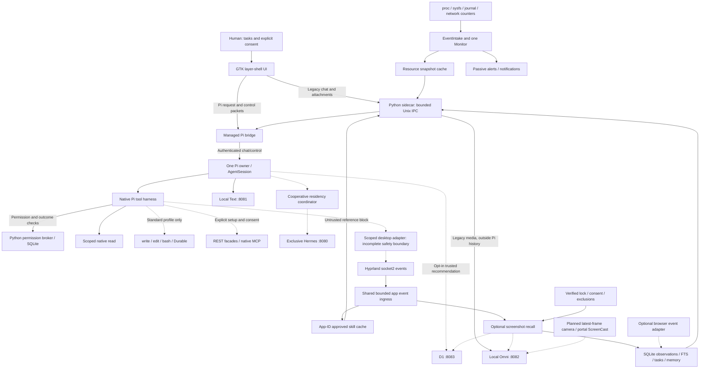

# Hyprneuro — Architecture and Development Audit

Audit date: 2026-11-14 UTC. Source snapshot: `fc43267173d6c1386891c708c9ddcc77724ed3f7`.

## 1. Executive summary

**Classification: Functional Development Build — NOT production ready.**

Hyprneuro has a substantial local-first foundation: a native GTK desktop panel, streaming local inference, passive monitoring, searchable observations, an application/permission broker, and an actual Pi SDK owner with guarded native tools. A real installed GTK → local Text → exact-file read → tool result → continuation workflow has succeeded with human activation and separate read consent. This is a useful vertical slice, not evidence of a complete autonomous desktop assistant.

The source and installed application are different releases. The latest source contains independently reviewed cancellation fixes, but this audit found a further unbounded cancellation/SDK-idle wait that blocks a production release of that source. The installed `d3f3fa2` owner remains failed after a real cancellation, with its uncertainty guard retained. Capture is disabled; frame-based screen/camera awareness is planned, not implemented. Attachments use a separate legacy Omni path, not the Pi conversation. The deployed owner is an exact-file, parent-only read profile—not the broader standard harness. Native MCP source integration is tested, but live providers and coordinated Hermes operation remain unaccepted.

This audit also identifies previously underemphasized issues: model-supplied approval in the ordinary app-aware extension, desktop authority checks that can become stale across awaits, owner-scoped memory collisions, incompatible controller/store task contracts, incomplete durable consent correlation, and monitoring freshness ambiguity. Isolated fixture tests and historical pass counts do not eliminate these gaps.

**Shortest path:** finish one reliable, durably auditable parent-only conversation/tool lifecycle, then repair authorization boundaries and state contracts before adding broader autonomy. Do not combine deployment, new capture, desktop input, provider enablement and Hermes into one acceptance event.

### Scope and preservation

- Active development tree: `/home/ron/Workspace/hyprneuro-pi-owner-gtk`; clean at audit start and final inspection before writing this document. Remote feature branch also points to `fc43267`.
- Canonical `/home/ron/Projects/Hyprneuro` contains quarantined changes, including video work. It was inspected with `git status` only; nothing was cleaned, adopted or overwritten.
- Implementation worker paused at a safe boundary. No retirement signal, failed-unit reset, candidate preparation or deployment was in flight during this audit.
- Only this audit document is written in the repository. No application code, model configuration, service configuration or production database is modified.
- Runtime checks are read-only: unit/process metadata, binary hash and local health/model-list endpoints. No inference prompt, GUI action, camera/screen capture, provider query or permission grant is performed.
- Private conversation payloads, credentials and production database contents are not copied into the report. Existing sanitized receipts are evidence, not substitutes for fresh acceptance.

### Observed runtime baseline

Read-only observation around 2026-11-14 23:44–23:49 UTC:

| Item | Observation | What it does not prove |
|---|---|---|
| Sidecar | `hyprneuro.service` active/running, PID 3349621; entrypoint in `hn-final-d3f3fa2/staged/sidecar-entry.py` | Collector reliability or successful tool workflows |
| GTK | `hyprneuro-ui.service` active/running, PID 3349626; `/proc/.../exe` resolves to installed UI | Responsiveness or acceptance of latest source |
| Installed UI SHA256 | `7a634a9c0970d13ef7ec5732f71498d387d4c32e2a2c052d8676cc400c1e2560` | Matches installed reviewed `d3f3fa2`, not latest `fc43267` |
| Text | PID 3221439; port 8081 `/health=ok`, model ID `lfm-text` | Inference latency, quality or load behavior |
| Omni | PID 3221441; port 8082 `/health=ok`, model ID `lfm-omni` | Accepted screen/camera/video pipeline |
| D1 | PID 3221445; port 8083 `/health=ok`, model ID `lfm-decision` | Working GUI escalation routing or calibrated scores |
| Hermes/MoE | `lfm@moe.service` inactive/dead, PID 0 | Exclusive switching safety |
| Installed permissions | Sidecar arguments include `--no-allow-capture --no-allow-on-demand --no-allow-browser --no-d1-visual --no-retention-enabled` | Features available merely because source exists |
| Owner | Exact `d3f3fa2` unit is active/running; checkpoint phase `failed`, guard exists | A running process is not a usable owner |
| Owner evidence | Checkpoint SHA256 `3664c365392c2edfbdaa7a9a0e3d774008bf6faf7c85da7504e59ecc6b8e445f`; implementation-worker inventory pins PID 3356764/start 45955087 and lifetime flock inode 85184 | No recovery or lock-acquisition probe was performed by the audit |
| Desktop input binary | `/usr/bin/wdotool`, version 0.5.3 | Product integration or permission to control applications |

The user confirmed the latest normal-stack restart was user-initiated in the preceding workflow. This audit independently verifies present service identities/health, not the historical initiator.

## 2. Architecture overview

### Component responsibilities and source map

| Layer | Responsibility | Principal source |
|---|---|---|
| GTK frontend | Layer-shell panel, input, transcript, settings, attachments, Pi connection/consent/cancel presentation | `ui/src/hyprneuro.c`, `ui/src/pi-desktop.inc`, `ui/src/pi-picker.inc` |
| Python sidecar | Bounded same-user IPC, observation/broker/store APIs, passive collectors, legacy chat, managed Pi bridge | `python/src/hyprneuro/__main__.py`, `sidecar.py` |
| Managed owner bridge | Descriptor validation, asynchronous service/transport operations, authenticated chat/control forwarding | `pi_managed_bridge.py`, `pi_desktop_bridge.py`, `pi_owner_client.py`, `pi_owner_service.py` |
| Native Pi owner | One actual AgentSession, serialization, consent, checkpoints, uncertainty guards, cancellation and lifecycle | `extensions/pi-owner/host.mjs`, `owner.mjs`, `socket.mjs`, `cancellation.mjs` |
| Tool harness | Native read/write/edit/bash wrapping, exact workspace policy, broker/consent checks, outcome accounting, Durable policy | `extensions/tool-harness/index.mjs`, `workspace.mjs`, `policy.mjs`, `extensions/pi-owner/durable.mjs`, `read-bridge.mjs` |
| Providers | REST facades and actual Pi MCP extensions, exact nested-call permits, host-owned stdio lifecycle | `providers.mjs`, `native-mcp.mjs`, `native-calls.mjs`, `owned-stdio.mjs`, `stdio-anchor.mjs` |
| Inference/routing | Existing local servers, deterministic legacy routing, scheduled lanes, D1 advice and cooperative exclusive residency | `models.py`, `model_router.py`, `model_dispatch.py`, `residency.py`, `extensions/pi-owner/routing.mjs`, `extensions/tool-harness/residency.mjs` |
| App/event context | One compositor event ingress, bounded subscriptions, focus/app tracking, cached approved skill context | `app_events.py`, `event_stream.py`, `application.py`, `sidecar_sources.py` |
| Recall/persistence | SQLite observations/FTS/tasks/permissions/memory, URL provenance, optional semantic reranking, browser integration | `sidecar_store.py`, `recall.py`, `semantic.py`, `browser_ingest.py`, `integrations/chrome/` |
| Desktop/privacy | Typed Hyprland adapter, permission/lease/focus checks, lock verification, capture policy | `desktop.py`, `desktop_control.py`, `authorization.py`, `session_lock.py`, `temporary_capture.py` |
| Monitoring/telemetry | Passive bounded kernel counters, cached resource snapshots, alerts, distinct inference metrics | `monitor.py`, `event_stream.py`, `telemetry.py`, `agent.py` |
| Operations | Exact-source immutable bundles, private backups, staged verification, narrowly bounded app cutover | `scripts/prepare_app_release.py`, `verify_app_release.py`, `apply_app_release.py`, `deploy/` |

### Architecture diagram

Solid edges describe implemented paths, not necessarily enabled/live-accepted ones. Dashed edges denote optional, restricted, incomplete or planned capability. The future camera/ScreenCast node is not an installed capture service. Passive alerts do not autonomously execute investigations.

### Request flows

**Legacy text/media:** GTK snapshots bounded history and reviewed attachment bytes → sidecar `agent_chat` → direct local Text or Omni SSE → reasoning/answer deltas → UI. `agent.py` parses native reasoning and split `<think>` delimiters and retains answer-only history. PNG/JPEG/WebP and canonical PCM WAV have reviewed immutable attachment handling. This route has no executable Pi tools; media is explicitly labelled outside Pi tools/history (`pi-desktop.inc:58–61`).

**Managed Pi:** genuine folder selection → validate private exact descriptor → managed owner service/handshake → GTK sends text through authenticated chat transport → one Pi AgentSession → harness/native tool call → activation and exact-action consent → broker/workspace checks → actual native execution → persisted outcome/toolResult → same model continuation → UI. `host.mjs:135–164` makes tool loadout/profile explicit. Persistent service requires normal-only, parent-only, read-only and no children. No ambient extensions, skills, context files or prompt templates are discovered.

**Cancellation and recovery:** request generation binds a cancel to the existing authenticated chat. Latest source adds tool-admission fencing, owned fetch/body closure and SDK producer/idle proof for a narrow known-tool-free cancellation. A checkpoint-boundary cancellation remains unknown, correctly retaining the guard; it must admit no new prompt. Tool-bearing, transport-failed or uncertain work remains unknown and non-replayable. These fixes are source-reviewed at `fc43267`; installed live cancellation still failed. Disconnect is not shutdown: persistent owners intentionally retain their lifetime lock across normal disconnect. Explicit clean shutdown must close the session, persist `closed`, remove the guard and release the same kernel flock. A running failed owner retaining that lifetime lock is not by itself a stale-lock defect.

**Observation:** shared compositor event → bounded metadata policy/lock checks → D1 capture advice → frame acquisition → optional visual D1 → two independent Omni requests (OCR, UI description) → bounded text/metadata into SQLite. Default background accepted observation costs three inference calls, four with visual D1; an explicit permitted foreground observation skips D1 and uses two Omni calls. Early rejection/duplicate checks can stop work. Existing `recall.py` frame acquisition uses raw `grim`, not a portal. This is disabled in the installed service and is not an implementation of the requested portal-backed screen view.

**Skills:** app-ID change/startup activates an approved, bounded snapshot using an eight-entry LRU with revision invalidation. This is deterministic, zero-inference reference loading, not execution permission. Legacy adds the skill block; the isolated Pi owner does not receive that app context. Bundled Open-Meteo/briefing Markdown is not explicit owner skill registration.

### Local inference and orchestration boundaries

- Text :8081 handles normal chat/tools; Omni :8082 handles actual legacy multimodal requests; D1 :8083 is structured advisory/classification, not the agent executor.
- Hermes :8080 is intended as an exclusive escalation through existing `lfm` control and cooperative admission, with prior-subset restoration. All-client cooperation and live handoff are not accepted. Normal-only owner deliberately disables lifecycle control.
- `model_router.py` is a deterministic routing helper; it performs no inference and its presence does not prove every UI path uses it.
- GTK currently submits ordinary chat-role text; D1/Hermes advice needs trusted `recommend=true` control wiring absent from that path. Source routing capability is not automatic GUI routing.
- Pi owns conversation/tool orchestration. Python remains broker/observer/legacy media infrastructure, not an equivalent second native tool loop. Nevertheless, there are two user-facing chat engines with different histories, permissions and media behavior; this is the largest integration seam.

### Persistence, logging, performance and trust

SQLite/WAL stores observations/FTS, journal cursors, tasks, authorization rows, memory and skills; Pi owns native conversation journals and outcome/checkpoint records. These are distinct persistence systems, with independent identities and lifecycle contracts. Optional semantic search reranks a bounded recent candidate set, not a persistent vector index over the full archive. Owner compaction is disabled; long sessions lack an accepted context-budget/compaction strategy.

Positive controls include same-user/private socket boundaries, bounded inputs/outputs, explicit private roots, exact read paths, no ambient resources, default-off capture/providers, uncertainty guards, no automatic side-effect replay, and fail-closed lock checks. These controls are not a same-UID sandbox. Standard bash is host execution; group cleanup is not protection against arbitrary escaping descendants. Owner read-only isolation excludes the ordinary app-aware extension, which has a separate self-approval flaw described below.

Queues and counters are bounded and monitoring uses one resource sampler. However, awaiting alert delivery can stall that sampler; RPC response time does not establish sample freshness. Native inference usage exists, but the live GTK receipt still showed missing Prefill/Decode/Hit/Full values. No fresh latency, memory-pressure, thermal or throughput benchmark was run in this audit. Later extension errors accumulate in a startup-only error sink, while generic bridge errors and suppressed stderr make operational diagnosis harder (`host.mjs:162–166`, `pi_desktop_bridge.py:178–181`, `pi-desktop.inc:423–424`).

## 3. Development progress matrix

Evidence labels: **R** = fresh read-only runtime observation in this audit; **S** = inspected source; **H** = retained historical test/live receipt; **T** = fresh isolated audit test. Complexity/remaining work is an estimate, not a percentage, delivery commitment or claim of complete requirements.

| Subsystem | Status / evidence | Blockers and dependencies | Estimated remaining effort |
|---|---|---|---|
| Startup/services | Functional installed build; R active UI/sidecar and exact installed binary | Failed owner; current source not deployed; no full recovery/soak acceptance | Moderate integration/operations |
| Legacy local chat | Implemented and historically live; S `agent.py`, H UI receipts | No tools; different session/history from Pi | Small hardening; unification larger |
| Native parent-read slice | H real human activation/read/local continuation; S strong exact-profile controls | Durable consent UUID gap; current installed owner failed | Moderate, highest-value slice |
| Cancellation | Latest S narrow corrections reviewed + H 14 SDK cancellation regressions; T stalled-ack injection | New audit P1: complete abort/idle proof not deadline-bounded; installed live cancellation FAIL | Moderate; source correction and live acceptance required |
| Disconnect/shutdown/restart | H real-SDK/private broker proves disconnect lock retention and explicit close exit 0/flock release | Installed failed runtime preserved; unknown outcomes intentionally block reuse | Moderate acceptance and UX work |
| Native read/write/edit/bash | S guarded standard profile, H fixture tests | Only exact read is deployed; no accepted production maintenance profile; bash unsandboxed | Moderate policy/integration |
| Durable children | S actual SDK/Durable integration | Parent-only deployed; child idle/lifecycle acceptance unresolved | Large integration/acceptance |
| Native MCP / REST providers | S native Pi registration + cleanup; H same-session SDK tests | Live schemas/auth/destination pairing unverified; defaults off | Moderate per provider |
| Deterministic routing | S Text/Omni/D1 helpers, R expected model IDs | Multiple paths do not share one router/session | Moderate integration |
| D1 → Hermes | S advisory/coordinator/lifecycle controls, H mock compatibility | GTK advice not wired; all-client admission/exclusive handoff unaccepted | Large/high risk |
| Monitoring | S broad passive counters/cache; R CPU/RAM historically rendered, H fixture lifecycle | Stale sample age; per-model PID identities not supplied in production; no KV/Vulkan allocation truth source | Small freshness fix; moderate acceptance |
| Journal/network alerts | S bounded intake/replay/passive observations | Sustained failure/recovery behavior unaccepted; no automatic maintenance execution | Moderate acceptance |
| Observation SQLite/FTS/UI search | S substantial storage/query/retention implementation; H stored-record search | Full ingest→restart→same-record recall lifecycle not accepted | Moderate |
| Tiered memory | S implemented; T cross-app overwrite reproduced in memory | Identity lacks scope owner; migration/backward compatibility; user-facing deletion incomplete | Moderate fix/migration |
| Semantic retrieval | S optional loopback embedding reranker | Default off; bounded recent candidates only; no live embedding acceptance | Moderate; optional initially |
| Browser ingestion | S extension/native host/token/provenance filters | Disabled installed; end-to-end installation/restart/privacy acceptance absent | Moderate |
| App awareness/skills | S shared ingress/cache/lifecycle; H cache tests | Pi context not connected; briefing/weather not owner-loaded; no ambient skill enablement intended | Moderate |
| GTK interaction/settings | S substantial UI; H multiline/history/size/settings tests | Enter results mixed; restart history/native metrics missing; no final usability soak | Moderate |
| Static images / WAV | S reviewed bytes/preview/playback, H legacy live acceptance | Required same-Pi-owner conversation/tool/history parity absent | Large integration |
| Screen/camera/mic view | S UI says unavailable; plan only | Portal/session/consent/lock/release/latest-frame pipeline missing; no capture acceptance | Large/new feature |
| Screenshot recall | S raw-grim legacy path + D1/Omni/storage tests | Not portal-backed; installed off; mocks are not live privacy acceptance | Large policy/transport acceptance |
| Video | Disabled; H retained native teardown/cleanup failures | Project retains prior provider-refusal boundary; technical root cause unresolved | Unknown, externally constrained |
| Desktop/application actions | S bounded Hyprland mutations and leases | Self-approval path and final dispatch revocation race; no input adapter; config excludes installed `wdotool` | Large safety/integration |
| Assistant CLI/task controller | S contract mismatch with real store | String vs integer IDs, `state` vs `status`, fake mirrors mismatch | Small–moderate repair |
| Release/rollback | S reviewed immutable bundle/backup/preflight tooling; H several real app updates | Repeated discovered ops defects; process-level dependencies/manual recovery; source/runtime divergence | Moderate simplification/acceptance |
| Full production acceptance | Not complete | No mixed-workflow soak, repeated performance groups or fully accepted recovery; mandatory media gaps | Large; no defensible date |

Do not sum these effort labels or treat them as a completion percentage. Work overlaps and the production requirement includes unresolved external/video decisions.

## 4. Critical issues and gaps

Severity: **P1** = blocks safe expansion or a required dependable workflow; **P2** = material reliability/integration/operational debt. No verified P0 finding was established. Conditional exposure is stated explicitly.

### P1-A: Model-facing app-aware API can assert human approval

`extensions/app-aware.ts:154–182` exposes `approved` as a model parameter and forwards it to `auth_create`/`auth_expand`. `sidecar.py:213–230` accepts it; `authorization.py:106–119,173–189` treats the boolean as sufficient approval for privileged operations. This extension also exposes leases/desktop actions. A same-user transport check cannot distinguish model assertions from actual human consent.

**Exposure:** ordinary app-aware package path, not the isolated parent-read owner (which excludes the extension). Do not report this as proof of an exploit against the current exact-read profile.

**Required:** remove grant/expansion from model-callable authority; allow inspection/proposals only. Resolve grants through a separately authenticated trusted human channel bound to action/scope/request. Add real boundary tests showing `approved:true` in model arguments cannot grant privileged operations.

### P1-B: Desktop checks can expire or be revoked before dispatch

`desktop_control.py:180–199` checks permission/lease, then awaits focus validation, then acts without rechecking. `expected_window` is optional; broker checking omits app identity. `desktop.py:38–44` adds an awaited version lookup before dispatch. Revocation/pause/expiry during these awaits can be bypassed by an already-started request.

**Required:** mandatory target/app binding for target-sensitive actions and authority revalidation at the final controlled dispatch boundary; barrier tests for revoke, expiry, pause, emergency release and focus changes. Do this before connecting `wdotool` or broad bash GUI automation.

### P1-C: Current installed owner cancellation/lifecycle remains failed

Historical live Cancel left unknown state; the process is still active, its guard retained, and UI is disconnected. Latest reviewed source distinguishes a proven local tool-free cancel from uncertainty and closes the checkpoint-admission race. That is source/mock proof, not installed live acceptance.

**Required:** preserve the current unknown record; reviewed bounded retirement and immutable release review; live known cancel → next no-tool turn → disconnect/reconnect → explicit shutdown/restart tests. Never delete a guard or replay an unknown request to make acceptance pass.

### P1-C2: Complete cancellation proof is not bounded by its advertised drain timeout

`owner.mjs:159–160` awaits `aborting` and `session.waitForIdle()` before entering the two-second `CancellationScope.drained()` proof budget. The request deadline aborts a signal; it does not force these awaited SDK promises to settle. The installed SDK's `abort()` also waits for idle.

An independent private diagnostic set a 25 ms call budget and withheld only the abort acknowledgement. After 76.72 ms the request was still pending, the proof timer had not started, phase remained ordinary and checkpoint remained chat-intent. Releasing that private acknowledgement allowed cleanup and a known-cancel result. This is reproducible failure-injection evidence of an unbounded boundary, not proof that the default live SDK currently hangs.

**Required before a new production bundle:** bound the entire abort + idle + drain sequence, not just the final body proof. Expiry must seal admission, persist unknown when possible, retain the guard and prohibit replay; it must not assert remote compute termination or release ownership on an unproven shutdown. Track any still-running cleanup and prevent later work from reentering. Commit the stalled-ack regression. The prior narrow correction approval does not clear this newly found broader liveness defect.

### P1-D: Tiered memory collides across owners

Persistent schema uses `PRIMARY KEY(scope,key)` (`sidecar_store.py:165–173`) and upsert replaces owner fields (`524–528`); `TieredMemory` similarly uses `_mem[scope][key]` (`application.py:448,463–466`). Audit synthetic check stored one key for app A and then B: recall for A became empty, B remained.

**Required:** owner-qualified identity per scope, consistent read/write/promotion semantics and a reversible schema migration with collision policy. Cover same-key distinct task/app/project owners and global scope; do not infer tenant isolation from filters applied after overwrite.

### P1-E: Exact human action decisions are not durably correlated

`owner.mjs:14–31` maintains pending consent IDs/booleans in memory without distinct persisted request/decision records. `final-native-chain-gui-cancel-blocked.json:42–52` acknowledges this; the human confirmed both dialogs separately. Native outcomes and broker flags are not a reconstruction of the exact approval decision.

**Required:** persist bounded request ID, action/scope identity, decision and time before dispatch, with denial/cancellation semantics and no secret dialog payload. Correlate to tool execution/outcome; fail closed if the required audit write fails. Existing ordinary-read broker `approved=0` is not proof that the human denied the read—it has different privileged-policy semantics.

### P1-F: Required multimodal/session parity and capture are missing

GTK attachments deliberately enter legacy chat (`hyprneuro.c:869,912–919`), with direct Omni at `sidecar.py:504–511`; the label correctly warns there are no Pi tools/history. Screen/camera/mic capture is explicitly unavailable (`1598–1623`). Continuous video-file support is disabled.

**Required:** separately reviewed same-owner image/WAV support, then a consent-backed latest-frame screen/camera implementation. Maintain a clear difference between synthetic-frame tests, authorized real capture, model submission and installed GUI acceptance. A prior provider rejection is a recorded project execution constraint, not evidence that all benign frame-based camera work is inherently prohibited.

### P2-A: Assistant controller/store contracts disagree

`assistant_controller.py:75–79` demands string IDs while store `task_get` requires integers (`sidecar_store.py:649–656`). Stream examines `state` as lifecycle, while the real store returns lifecycle in `status` and structured data in `state`; pause/resume overwrite data rather than change status (`126–146`). Fake controller tests repeat the incompatible contract.

**Required:** one explicit typed task schema and real-store/disposable-IPC tests; pause maps to `suspended`, resume to `active`, terminal checks inspect `status`.

### P2-B: Cached resources lack freshness semantics

One sampler awaits alert delivery before the next sample (`event_stream.py:249–260`, `monitor.py:257–266`). RPCs stamp fresh response time, not sample time (`sidecar.py:539–573`). Missing age can make stalled values look current.

**Required:** monotonic sample age/sequence, bounded stale threshold and unavailable stale fields. Keep one sampler; do not solve this by adding per-RPC reads or a second poller.

### P2-C: Disconnected context, advice, metrics and long-session policy

Pi submission is text-only; app context/skills enrichment remains in Legacy. GTK does not request trusted `recommend=true` or render all advice events. Native usage does not populate live GTK metrics; compaction is disabled. These are incomplete connections, not separate completed features.

**Required:** explicit versioned snapshot/handoff contracts, real GUI event tests, accurate missing metrics, context-budget warnings before adding safe compaction. Do not enable ambient discovery merely to fill these gaps.

### P2-D: Operational and documentation complexity

Multiple frozen releases, quarantine trees, guard/checkpoint locks, exact-unit policies, source-only vs installed fixes and growing evidence ledgers make the correct next operation hard to establish. Older `IMPLEMENTATION_STATUS.md` and `PRODUCTION_TEST_REPORT.md` headers still describe superseded roots. Later extension diagnostics are weak, and dense orchestration files raise review cost.

**Required:** one generated current-state manifest (source/installed/root/profile/last accepted gate), historical docs explicitly marked, bounded stage/correlation diagnostics, a documented recovery state machine, and fewer repeated manual approval loops for already-authorized non-consent tasks. Preserve the immutable-release and no-replay guarantees rather than removing safeguards for convenience.

## 5. Production readiness assessment

**Functional Development Build** is the most accurate requested category.

- More than a prototype: real local inference, native UI, passive collectors, SQLite/FTS, reviewed release operations and a genuine human-approved native-tool workflow exist.
- Not feature-complete: same-owner multimodal support, portal capture, `wdotool` product integration, explicit owner skills, live providers, broad maintenance/autonomy and GUI escalation are absent or incomplete.
- Not a production candidate: current live owner is failed; cancellation fix is not deployed/live-accepted; authority and state isolation flaws remain; recovery/soak/performance acceptance is incomplete.
- Not production ready: all-media requirement is unmet, independent of whether reduced-scope parent-read acceptance can be completed soon.

A narrowly scoped **parent-only read assistant release candidate** is plausible after the critical vertical slice passes. That would be a reduced-scope milestone—not full application production readiness. No inference benchmark or deadline can be justified from health checks and fixture test counts.

## 6. Orchestrator benchmark scorecard

This is a self-assessment informed by independent source reviewers, not an external blind benchmark. Scores cover the observed development orchestration as well as this audit; full credit is withheld for missing live acceptance and inefficiency.

| Dimension | Weight | Score /10 | Weighted points /100 | Evidence, limits and improvement |
|---|---:|---:|---:|---|
| Architecture comprehension/accuracy | 25% | 8 | 20.0 | Correct separation of owner/observer, native MCP vs REST, source vs installed and fixture vs live. Audit found additional seams and real defects. Earlier blanket framing of video refusal was overbroad; routability/context integration had been overstated. Maintain an executable capability map. |
| Tool selection/execution/orchestration | 25% | 7 | 17.5 | Isolated writers, independent pinned reviews, actual-SDK regressions, normal non-force pushes and preserved failed evidence. Several bugs escaped initial suites; long-lived worker/review loops and delegated fixtures required correction. Add adversarial boundary tests before broad suites and keep reports bounded. |
| Planning/dependency reasoning | 20% | 6 | 12.0 | Explicit plan/checklists, smallest read-only profile, source→bundle→live gates, no silent permission expansion. Repeated root pinning, retirement approvals and release-policy revisions delayed the vertical slice; broad feature work accumulated disconnected components. Freeze one vertical-slice contract first. |
| Real-world testing/verification | 20% | 7 | 14.0 | Genuine native read/local continuation, real GUI failure discovery, local stack health, actual-SDK/broker/flock regressions, sanitized builds. Latest cancellation is still mock/live-unaccepted; no capture/provider/Hermes/soak acceptance. Fresh audit runtime checks are health only. Use a small repeatable installed scenario matrix. |
| Efficiency/context/recovery | 10% | 4 | 4.0 | Preserved checkpoints and safe paused state; resumable durable jobs. Very large accumulated context, repeated consent-adjacent clarification loops, historical false-pass fixes and provider stalls consumed significant effort. Many source-only pass reports did not advance deployed usability. Bound worker generations and summarize authoritative state. |
| **Total** | **100%** | | **67.5 /100** | **Not an objective product quality or safety score.** |

Calculation: `8×2.5 + 7×2.5 + 6×2 + 7×2 + 4×1 = 67.5`.

### Observable execution accounting

- Parent audit instrumentation at the report-validation counting checkpoint recorded **29 direct tool calls**: 7 subagent-control calls, 11 Bash calls, 5 reads, 4 codemode calls, 1 report write and 1 report edit. Codemode contained 17 nested file reads. Final documentation/checkpoint calls are outside that snapshot; delegated tool calls are not included. This is a precisely bounded observation, not an invented project-wide total.
- That snapshot contained **zero parent tool-result error records**. Delegated verification did retain the strict C compilation failure described below; no all-commands-succeeded claim is made.
- Three independent read-only audit assignments were created; implementation was paused and acknowledged no operation in flight.
- Historical cancellation work retained: unsafe `/tmp` fixture-environment rejection; a 91/92 Node run exposing asynchronous checkpoint-test timing; independent checkpoint-admission P1 reproduction; before-fix C rendering failure; corrected full 93-test Node result. These are real failures/retries, not erased by later pass counts.
- Historical final-cancellation correction receipt reports 478 Python + 138 subtests + one optional skip, 93 Node, and 24 normal + 24 sanitizer C checks. Audit reviewers hash-checked retained logs; this audit does not relabel them fresh full-suite execution.
- Pre-audit implementation-worker cumulative counters reported approximately **69.35M input tokens, 529.7K output tokens and $14.82**. These are workflow-reported accounting, not elapsed time, inference tokens, total-project spend or proof of value. Cached input/reused context makes token volume unsuitable as a direct productivity measure.
- No throughput, GUI frame timing, model-response latency or final soak success rate was freshly measured. No invented coverage percentage, retry rate or benchmark percentile is supplied.

Fresh isolated audit-test results and their exact scope are recorded in the verification addendum below.

## 7. Prioritized, dependency-aware roadmap

Complexity estimates: **S** = localized change/focused tests; **M** = cross-component contract or migration; **L** = new integration and significant live acceptance. These are relative estimates, not calendar commitments. Tasks that affect code require a separate implementation authorization/work phase; none are performed by this audit.

| Order / priority | Objective and impact | Components | Dependencies/blockers | Required verification | Complexity |
|---|---|---|---|---|---|
| 1 / P1 | Bound the entire cancellation/idle sequence, establish one current-state manifest and finish the parent-only lifecycle slice; restore daily usability | `owner.mjs`, `cancellation.mjs`, bridges, GTK includes, release scripts, plan | New P1-C2 source fix/review required before freezing; preserved failed owner needs explicitly bounded transition; exact bundle review; fresh human permissions | Installed version attestation; human activation/exact read; no-tool stream→Cancel→next turn; late-tool/error unknown retention; disconnect/reconnect; explicit shutdown exit0 and same-inode flock release; restart/history; no silent replay | M |
| 2 / P1 | Remove model-supplied grant authority and harden desktop final dispatch before broad autonomy | `app-aware.ts`, `authorization.py`, `sidecar.py`, `desktop_control.py`, `desktop.py` | Do not enable ordinary app-aware/desktop privileges until fixed | Model `approved:true` cannot authorize; trusted human correlation required; revoke/expiry/pause/focus changes at every awaited boundary deny dispatch; real broker/adapter tests | M |
| 3 / P1 | Persist action-level consent and outcome correlation | `owner.mjs`, harness policy, store/bridge audit events | Agree durable bounded event schema; must precede permission-dependent dispatch | Unique request/action IDs; allow/deny/cancel/timeouts persisted before execution; database/audit failure denies; restart reconstructs decisions without secret payload; no replay | M |
| 4 / P1 | Repair scoped memory identities without losing user data | `application.py`, `sidecar_store.py`, migrations/tests | Backup/migration strategy; decide ownership rules/global scope | Same key in different owners survives writes/recall/promotion; migration is reversible; old ambiguous collisions reported, not fabricated recovery | M |
| 5 / P2 | Repair controller/store contract and expose truthful errors | `assistant_controller.py`, `assistant_cli.py`, task IPC/store | Typed shared task schema | Real disposable store/IPC select, stream, pause/resume, terminal status, emergency-stop tests; structured state remains intact | S–M |
| 6 / P2 | Add monitoring freshness and wire known model process identities | `event_stream.py`, `monitor.py`, `sidecar.py`, telemetry UI | Lifecycle owns identity; no PID autodiscovery or second sampler | Slow alert delivery yields stale/unknown status; zeros distinct; disable/stop/restart clears cache; PID reuse/missing process; no per-RPC reads; live counters correctly labelled | S–M |
| 7 / P2 | Carry bounded app context and reviewed skills into Pi explicitly | bridge/owner, app-event cache, explicit resource loader, skill catalog | Privacy/context contract; no ambient discovery | App change loads once; title changes no reload; revision invalidates; untrusted text cannot authorize; bounded same-session context; Open-Meteo only via authorized HTTP capability | M |
| 8 / P1 feature gate | Add same-owner static image/WAV ingestion and honest metrics/history | GTK attachments, bridge, owner model adapters | Reviewed multimodal profile, explicit consent and media limits | Exact reviewed bytes, supported media schemas, local Omni result in same native session, replay/remove/cancel/error/reconnect; no silent legacy fallback; actual metrics semantics | L |
| 9 / P1 feature gate | Implement independent latest-frame screen/camera view safely | new portal/device lifecycle component, GTK preview, lock/capture policy, Omni adapter | Explicit source design; capture/submission scopes; same-owner media contract | Portal denial/cancel/Request.Close; camera Start/Stop; lock/focus/device loss; one in-flight/latest-only frame; no recording/backlog; no raw capture fallback; human-approved real local Omni/UI tests | L |
| 10 / P2 | Introduce narrowly scoped `wdotool` actions only after authority fix | desktop adapter/config, future input facade, observe-act-verify controller | Tasks 2, 7, 9; installed capabilities inspected | Fresh frame/geometry/scale/focus binding; no stale-screen clicks; one-shot bounded key/type/click/scroll; release held inputs on cancel; human security dialogs never auto-approved; stop and bounded retries | L |
| 11 / P2 | Enable one provider and one Durable workflow at a time | native MCP/harness, owner/Durable, provider setup | Discovery/auth/destination pairing; parent-read success; child lifecycle fix | Real provider schema and explicit approved query; cancellation/no orphan; no raw native bypass; child idle/shutdown/cross-process outcomes; faults never replay effects | M–L |
| 12 / P2 | Complete coordinated D1/Hermes/UI escalation | routing, residency clients, trusted GTK events | All cooperating clients use admission; memory/residency budget; explicit opt-in | D1 confidence semantics; deny/cancel; exclusive Hermes; prior-subset restoration under failure; no simultaneous inference conflicts; real local trials | L |
| 13 / P1 release gate | Reconcile video requirement and legitimate execution constraints | media plan and existing evidence, no unsafe enablement | Technical failures plus recorded provider boundary; cannot assume a rewrite clears it | Preserve failed repros; separately permitted repair path and real preview/play/cancel/cleanup/model acceptance, or an explicit user-approved product-scope change; neither is currently satisfied | Unknown |
| 14 / P1 release gate | Run final installed mixed-workflow reliability/performance acceptance | all accepted components, CI/acceptance scripts, reports | Earlier required feature/security gates closed | Repeated cold/warm turns, restart/revoke/network/portal/model failures, long session, low-memory behavior, no orphan/leak/unknown silent takeover; ≥20-trial groups where planned; latency/RSS/thermal percentiles from actual data; rollback rehearsal | L |

Keep optional semantic embeddings and automatic maintenance out of the first dependable slice. System/package changes, unrestricted shell, automatic input recording and blanket capture are not shortcuts to readiness.

## 8. Immediate next three actions

1. **Close the newly found cancellation liveness boundary, then complete the parent-only lifecycle release.** Add the stalled SDK-ack regression and a deadline across abort/idle/drain; independently review the new source before freezing anything. Preserve the current failed owner; execute only the explicitly authorized bounded transition after fresh checks, prepare/review an exact corrected bundle, then test known cancellation and subsequent chat in the actual installed GTK/local-LFM path. Exit criterion includes clean explicit shutdown and lock release—not just a signal delivered or a successful fixture quote.
2. **Close the authority boundary before enabling desktop/standard app-aware mode.** Remove model-controlled `approved` grants; require target/app identity and revalidate lease/authorization immediately before compositor dispatch. Add adversarial real-contract tests. Keep those capabilities disabled meanwhile.
3. **Make approved native actions durably auditable.** Persist request/decision/action/outcome correlation without private dialog payloads; test denial, persistence failures and restart. This converts the strongest existing read workflow into a reproducible, supportable release gate rather than a manually corroborated one-off.

Memory identity repair is the next immediately actionable state-integrity task and can run in an isolated branch in parallel with the first slice, provided a non-destructive migration plan is reviewed. Do not start new capture/input features before the authority boundary work lands.

## 9. Verification addendum and limits

Independent audit test artifacts: `/home/ron/Workspace/a-fc43267-7nN7/`. These tests used a clean `env -i`, private Workspace HOME/TMPDIR/XDG, bytecode and pytest caches disabled, offline flags and the existing Python venv. Tests used synthetic/private state and loopback mock inference, not production model inference or production broker requests.

| Fresh audit check | Result and limit |
|---|---|
| Eight selected release tests plus correlated cancellation bridge selection | **10 passed, 23 subtests**, 0.13 s; service/write actions were mocked |
| Actual installed SDK, private synthetic HTTP: known cancel, stalled headers, stale/cross-connection request, late fetch fence, checkpoint race | **5 passed**, 1,179.28 ms total; not live LFM acceptance |
| Additional stalled-abort-ack diagnostic | **1 passed**, 140.94 ms; this is a successful reproduction of P1-C2, not a product-acceptance pass |
| Fresh headless production C cancellation cases | **2 passed** |
| Same C cases, fresh ASan/UBSan with leak checking | **2 passed**, no sanitizer diagnostics |
| Strict C build | **Failed with two GTK deprecation errors** at `hyprneuro.c:724,726`; explicit normal-policy rebuild and separate sanitizer build succeeded with retained warnings |
| Parent synthetic scoped-memory check | Reproduced cross-app overwrite using only in-memory `TieredMemory`; no production data touched |

There were **no test retries** in that reviewer run. There was **one changed-policy C compilation retry**; successful builds are not compiler-warning-clean. Python warnings were errors, Node warnings threw, and GLib runtime warnings were fatal in those fixtures. Exact commands and outputs are retained in `run-focused.sh`, `focused-summary.log`, `idle-boundary.mjs` and `idle-boundary.log`.

Independent evidence checks matched **26/26** cancellation receipt path/source hashes, **25** historical release-artifact hashes and **46** native/GUI receipt artifact hashes. All **265/265** installed bundle source blobs match its manifest and exact `d3f3fa2` Git objects. These counts are checked artifacts, not code-coverage or test counts; no full historical suite was rerun.

The latest checkpoint is `failed`, not the earlier receipt's `chat-unknown`. The reviewer verified that its current journal preserves the earlier journal byte-for-byte and appends one custom failed-phase entry, with no additional native message, after the authorized pre-audit Disconnect. That explains changed hashes without erasing the historical failure. Independent journal checks found four user messages, one native read and a successful 24-byte fixture-matching result; this is consistent with the saved human-approved workflow, not new inference performed during this audit.

Orchestrator `done/ok` means the reviewer completed its assignment; it does **not** override a textual BLOCK verdict. Historical duplicate/cumulative attention records do not permit a defensible unique total cost, full tool-call count or project-wide retry rate. Source findings outside the narrow focused test selection were not cleared by its passing results.

### Principal evidence references

- `docs/FINAL_IMPLEMENTATION_PLAN.md` — newest sequential acceptance/operational ledger; not all older status headers agree.
- `docs/evidence/final-native-chain-gui-cancel-blocked.json` — genuine native read/continuation, GUI partial results, consent-audit limit and failed installed cancellation.
- `docs/evidence/final-cancellation-source-validation.json` and `final-cancellation-review-correction.json` — source/hash/full-test evidence and retained failures.
- `docs/evidence/final-real-broker-clean-shutdown.json` — private actual-SDK/broker/SQLite/flock proof, not installed lifecycle acceptance.
- `docs/evidence/native-mcp-source.json`, `native-mcp-p1.json`, `native-mcp-integration.json` — MCP fixture integration and cleanup scope; live provider limits.
- `docs/P12_MONITORING.md`, `docs/evidence/p12-passive-snapshot.json` — passive counter labels and lifecycle contract.
- `docs/SKILLS.md`, `skills/openmeteo/SKILL.md`, `skills/briefing/SKILL.md` — bundled instruction resources, not runtime tool registration.
- Independent read-only audit calls: `01M7E74DPVDGC8D963XF62P3SE/architecture`, `01M7E74XK0100CHAA4SYJKZ27S/state-media`, `01M7E75AKT6V1GCWZXZJRFNEWK/tests-progress`.

This report does not authorize implementation, recovery signals, failed-state cleanup, new inference/capture, tool activation, production database writes or deployment. The implementation worker remains paused for the audit.
